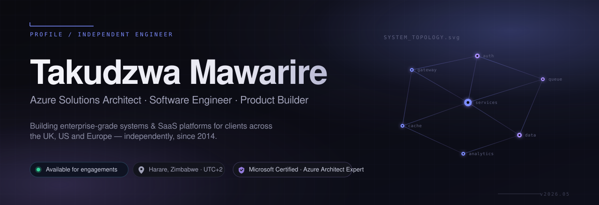
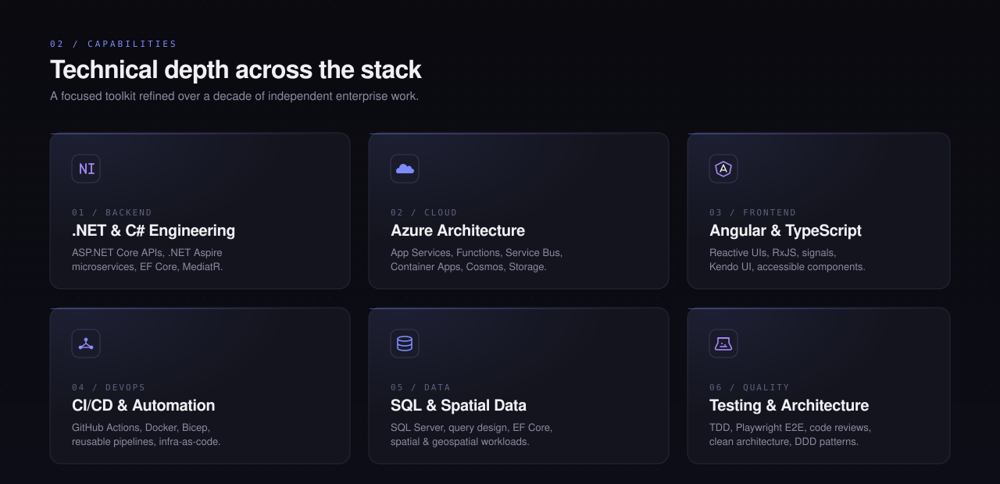
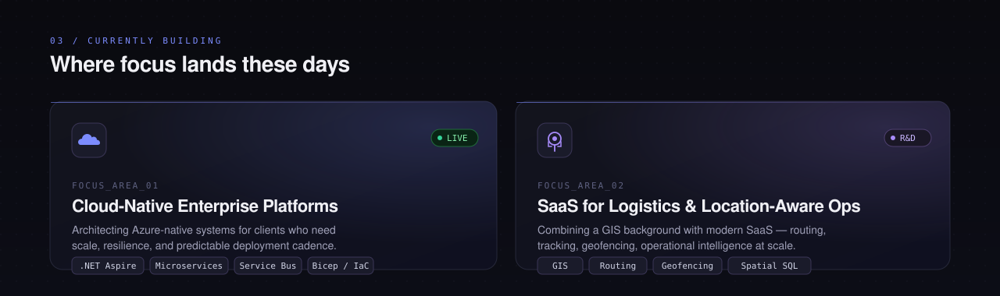
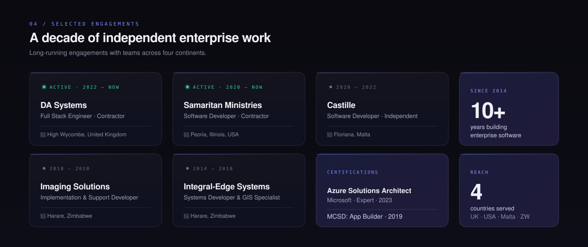
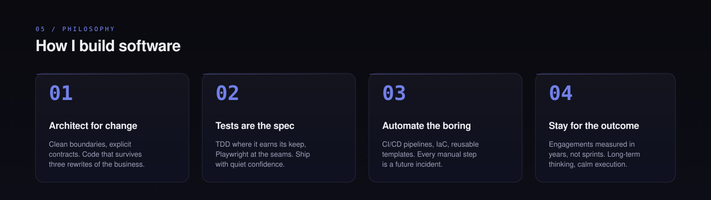

<!--
  README.md — tkmawarire/tkmawarire
  ─────────────────────────────────────────────────────────
  Premium dark-first GitHub profile, fully responsive on both
  desktop and mobile, with light/dark mode handled by the
  <picture> tag and prefers-color-scheme.

  Design notes:
    · All hero/section visuals are local SVGs under /assets
      (no external CDNs, no JS, no iframes — fully GitHub-safe).
    · Native SVG <text> elements only; no <foreignObject>, so
      rendering is identical across GitHub's image proxy and
      all browsers.
    · A single external service is used: github-readme-stats
      (Vercel), themed to match the rest of the page.
    · Markdown links sit below each visual section so screen
      readers and link-clickers both get real content.
-->

<!-- ─── Hero ────────────────────────────────────────────── -->

  <picture>
    <source media="(prefers-color-scheme: dark)" srcset="assets/hero-dark.svg">
    <source media="(prefers-color-scheme: light)" srcset="assets/hero-light.svg">
    
  </picture>

  
  
  
  

 

<!-- ─── Intro paragraph ─────────────────────────────────── -->

  <em>Independent software engineer and Azure Solutions Architect. I design, 
  build and maintain enterprise-grade systems and SaaS platforms for clients 
  in the UK, US and Europe — with a calm, long-term approach to delivery.</em>

 

<!-- ─── Capabilities ────────────────────────────────────── -->
<picture>
  <source media="(prefers-color-scheme: dark)" srcset="assets/capabilities-dark.svg">
  <source media="(prefers-color-scheme: light)" srcset="assets/capabilities-light.svg">
  
</picture>

 

<!-- ─── Currently building ──────────────────────────────── -->
<picture>
  <source media="(prefers-color-scheme: dark)" srcset="assets/focus-dark.svg">
  <source media="(prefers-color-scheme: light)" srcset="assets/focus-light.svg">
  
</picture>

 

<!-- ─── Selected engagements ────────────────────────────── -->
<picture>
  <source media="(prefers-color-scheme: dark)" srcset="assets/experience-dark.svg">
  <source media="(prefers-color-scheme: light)" srcset="assets/experience-light.svg">
  
</picture>

 

<!-- ─── Engineering philosophy ──────────────────────────── -->
<picture>
  <source media="(prefers-color-scheme: dark)" srcset="assets/philosophy-dark.svg">
  <source media="(prefers-color-scheme: light)" srcset="assets/philosophy-light.svg">
  
</picture>

 

<!-- ─── GitHub stats ────────────────────────────────────── -->
<h3 align="center">
  <code>06 / GITHUB ACTIVITY</code>
</h3>

  <picture>
    <source media="(prefers-color-scheme: dark)" srcset="https://github-readme-stats.vercel.app/api?username=tkmawarire&show_icons=true&hide_border=true&bg_color=0a0a0f&title_color=7c8cff&icon_color=a78bfa&text_color=a0a1b8&ring_color=7c8cff&hide=contribs">
    
  </picture>
  <picture>
    <source media="(prefers-color-scheme: dark)" srcset="https://github-readme-stats.vercel.app/api/top-langs/?username=tkmawarire&layout=compact&hide_border=true&bg_color=0a0a0f&title_color=7c8cff&text_color=a0a1b8&langs_count=8">
    
  </picture>

  <picture>
    <source media="(prefers-color-scheme: dark)" srcset="https://github-readme-streak-stats.herokuapp.com/?user=tkmawarire&hide_border=true&background=0a0a0f&stroke=26283a&ring=7c8cff&fire=a78bfa&currStreakLabel=7c8cff&sideLabels=a0a1b8&currStreakNum=f0f0f5&sideNums=f0f0f5&dates=8a8ca3">
    
  </picture>

 

<!-- ─── Connect ─────────────────────────────────────────── -->
<h3 align="center">
  <code>07 / GET IN TOUCH</code>
</h3>

  <strong>Currently accepting select independent engagements.</strong> 
  Long-term enterprise builds · Azure architecture reviews · SaaS product engineering

  <a href="https://www.linkedin.com/in/takudzwamawarire/">LinkedIn</a>
  &nbsp;·&nbsp;
  <a href="https://takudzwa.azurewebsites.net">Portfolio</a>
  &nbsp;·&nbsp;
  <a href="mailto:takudzwamawarire7@gmail.com">Email</a>
  &nbsp;·&nbsp;
  <a href="https://github.com/tkmawarire">GitHub</a>

 

  <code>// Harare, Zimbabwe · UTC+2 · Engaging clients globally since 2014</code>

